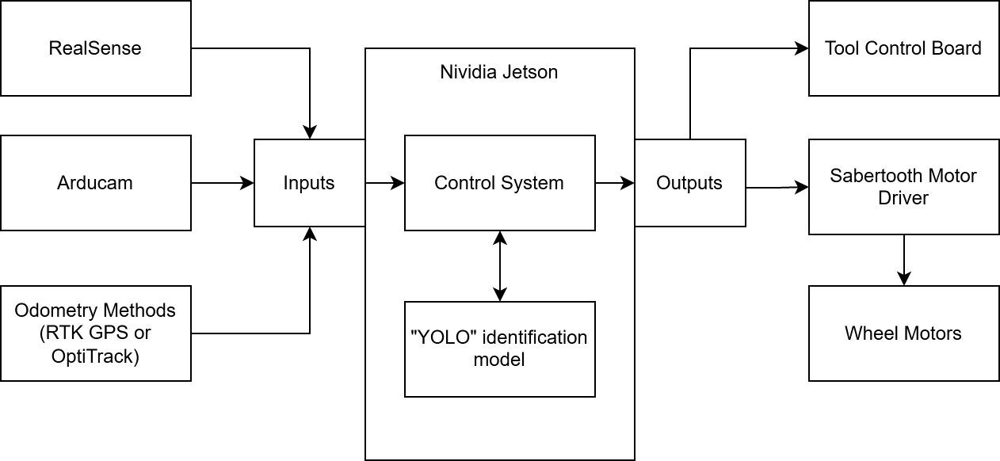
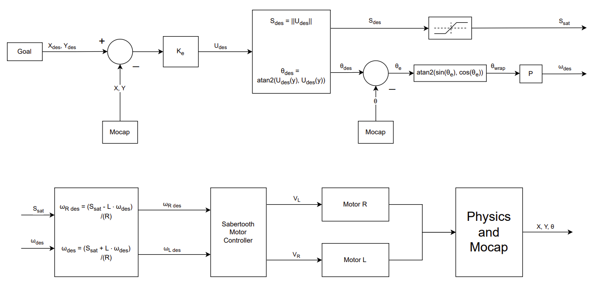
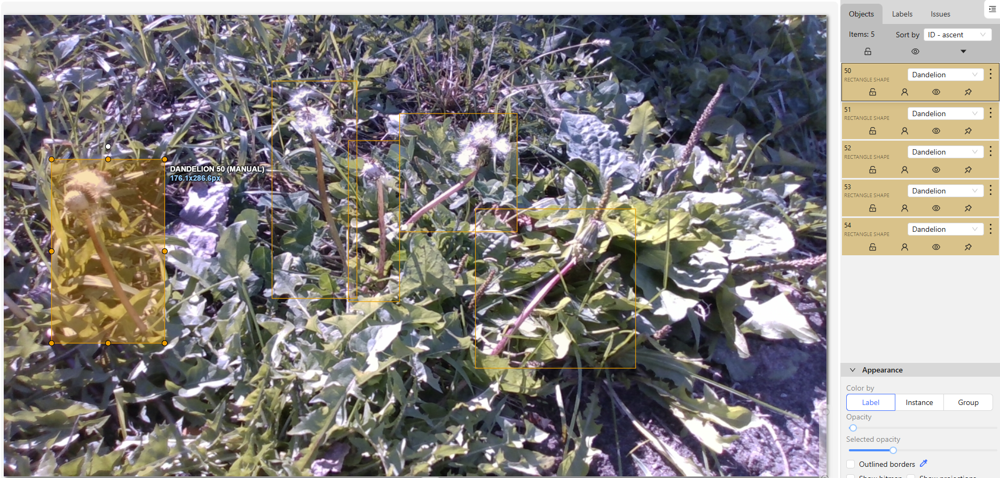
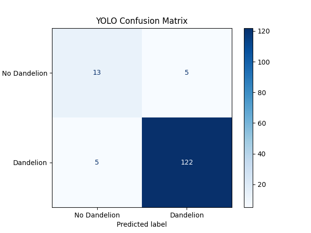

## Overview

An autonomous robot for home gardens and small farms that finds weeds with a camera and a trained detection model, drives to them on its own, and removes them mechanically with an auger or tine-weeder attachment. No herbicides, no hand weeding. Built over two semesters by a four-person team as our senior capstone, it **passed all 10 of its engineering specifications**, including **93.1% dandelion detection accuracy** and **96.1% precision**. I led all of the robot's software and autonomy work, from the motor drivers up to a ROS2 autonomy stack written in Python.



## The Problem

Weeds compete with crops for water, nutrients, and sunlight, and keeping them under control is a constant chore at every scale of growing. Today's options are all trade-offs: pulling weeds by hand is slow and physically demanding, herbicides harm the environment and the people eating the produce, and the commercial weeding robots that do exist are expensive machines built for large monoculture farms.

Our clients, Dr. Hamid Ossareh and Dr. Luis Duffaut, asked for a **low-cost autonomous platform for diverse, small-scale growing**: one that can navigate a garden, tell weeds apart from everything else, and remove them at different growth stages, from seedlings to mature, deep-rooted plants. This year's scope was to build the foundation of that autonomy, along with a robust multi-tool mechanical system, in a lab setting.

## My Role & Scope of Work

I was the team's **Software and Autonomy Lead** and developed the robot's software: the autonomy stack as a set of **ROS2** packages in **Python** on the Jetson, and the front-tool firmware in **C++ (Arduino)** on an ESP32. My teammates handled the mechanical design and the budget. The electrical side (the front-tool PCB and sensor integration) was led primarily by a teammate, with my help, especially on design choices.

- **Autonomous navigation:** a go-to-goal controller that turns the robot toward a target and drives it within a goal radius, plus waypoint path following for repeated passes through crop rows.
- **Control systems:** tuned the control gains that convert distance and heading error into speed and turn commands, and from there into voltage commands for the Sabertooth motor controller.
- **Motor drivers:** low-level drive code for the drivetrain, plus the stepper driver and drill motor on the front tool.
- **Odometry:** the positioning pipeline that feeds the controllers. In the lab it uses an OptiTrack motion-capture system as a stand-in for GPS, and it's structured so RTK GPS can replace it.
- **Dead reckoning:** a calibrated, feedback-free position estimate from motor commands, which let the robot run our off-site Design Night demo without OptiTrack or GPS.
- **Color-mask detection:** red-target detection for go-to-goal and blue-tape detection for path following in the demo, plus tools to re-tune the color masks for a new environment.
- **Virtual twin:** a simulated copy of the robot, driven purely by dead reckoning, that mirrors the real robot's motion.
- **ArUco re-homing (stretch goal):** a homing sequence that uses pre-placed ArUco markers to relocate the robot if it gets lost.
- **Operator GUI:** a PyQt front end for controlling the robot, showing the virtual twin, and switching between modes of operation.
- **Machine learning & image classification:** led the capture and annotation of a dandelion dataset of 700+ images, with help from the whole team, then trained and evaluated YOLO and DETR detection models and deployed one on the robot.
- **Machine vision:** a bird's-eye-view transform of the camera feed to estimate where a detected weed sits relative to the robot.
- **Tool actuation firmware:** the front-tool firmware in C++ (Arduino) on the ESP32: a serial command protocol with the NVIDIA Jetson, sequencing of the lead-screw stepper and drill, homing, and distance sensing.
- **Electrical design support:** worked with the electrical lead on PCB and sensor-integration design choices.
- **System integration:** the top-level ROS2 behavior that switches between path following, weed pursuit, and tool actuation.

## System Design

The robot follows a planned path while continuously scanning for weeds. When the detection model spots one, it breaks off into go-to-goal mode, closes in on the weed, runs the tool, then returns to the path and keeps searching. Everything runs through an NVIDIA Jetson, which takes in both cameras and the position source and sends commands to the tool board and the drive motors. The software is organized as **ROS2 nodes written in Python**: separate nodes for each camera, the go-to-goal controller, path following, waypoint management, tool control, telemetry, the virtual twin, and the operator GUI, coordinated by a central commander node.

### Autonomy & Control

The core of the navigation is a **go-to-goal controller**. It takes the robot's position and heading plus a goal position, rotates the robot to face the goal, then drives toward it until it's within a set radius. The position error is scaled by a gain into a desired velocity vector. Its magnitude becomes a saturated forward speed, and its direction becomes a desired heading that a proportional controller tracks, with the heading error wrapped to ±π so the robot always turns the short way. Differential-drive kinematics then split speed and turn rate into left and right wheel commands for the Sabertooth motor controller.

**Waypoint path following** reuses the same controller on a sequence of pre-coded goal points. Its goal thresholds are deliberately looser, trading pinpoint accuracy for a smooth, continuous path through a row.



 alongside the RealSense (top) and Arducam (bottom) feeds.")

For positioning, a Pugh-matrix comparison of RTK GPS and the lab's **OptiTrack** motion-capture system favored OptiTrack for this year (28 vs. 22), because it was already set up in the lab and cost nothing. Because the odometry pipeline is built so the position source can be swapped, RTK GPS can be dropped in for outdoor use.

### Dead Reckoning & the Design Night Demo

Our public demo at Design Night was held indoors and away from the lab, so neither OptiTrack nor GPS was available, and those are the inputs the robot relies on in testing and deployment. To still demonstrate the full system, I built a self-contained demo stack around three pieces:

- **Calibrated dead reckoning.** Dead reckoning estimates position from motor commands alone, with no feedback, so wheel slip is its biggest enemy, and the demo room was carpeted. My **calibration script** handles this: the robot drives straight at full speed for four seconds and stops, the distance it actually covered is measured and entered, and the script saves a calibrated dead-reckoning ratio. The rest of the stack uses that ratio to turn motor commands into distance traveled on that specific surface.
- **Color-mask detection.** In place of the ML model and the positioning system, go-to-goal targets red test objects and path following tracks a line of blue tape. I also wrote color-sampling tools for both cameras: drag a box around a color in the live view, and they report its average RGB and HSV values and a recommended HSV mask range, so the masks can be re-tuned quickly for a new room's lighting.
- **Virtual twin.** A simulated robot that mirrors the real one's motion using only dead reckoning, shown live in the GUI so the robot's estimated position can be watched against where it really is.

### ArUco Re-Homing (Stretch Goal)

Dead-reckoning error builds up over time, so as a stretch goal I built an **ArUco-marker re-homing sequence**. The robot slowly spins in place until it has found all four pre-placed markers, calculates its distance from each, then centers itself on the home position and turns to face the "north" marker. The node worked and the robot moved as intended, but in the demo room (crowded with moving people, and with little color contrast) visual noise made detection too unreliable for the sequence to be practical there.

### Operator GUI

I built the robot's operator GUI in PyQt. I started in Pygame, but after some research found it struggles with GUI button handling and the peer-to-peer communication the project needed, so I switched. The GUI shows the dead-reckoning virtual twin, opens a camera window with both camera feeds and any detections, and has controls for:

- **Idle / stop**
- **Re-home sequence:** runs the ArUco re-homing.
- **Optical path following:** follows the blue tape with go-to-goal running alongside, so when a red target appears, the robot diverts to it to actuate the tool.
- **Go-to-goal only:** waits for a target, drives to it, and actuates the drill.
- **Teleop:** on-screen arrow keys for manual driving.
- **Drill controls:** re-home the drill, or stop it immediately with a drill e-stop.

A status panel shows the requested and confirmed mode, the current stage of re-homing and of drill actuation, and the calibrated dead-reckoning ratio.

 alongside the live RealSense and Arducam feeds detecting the blue tape path and a red target. Red callouts are from the user manual.")

### Perception & Machine Learning

An **Intel RealSense D435i** RGB-D camera on the mast captures the scene, and an **Arducam 8MP IMX179** covers the RealSense's blind spots. I led the capture and annotation of the dataset, with help from all of my teammates: **over 700 images** taken with the RealSense and annotated for dandelions in CVAT. The models were trained on 350 images and tested on 145 images they never saw during training.

I trained and compared two detection architectures:

| Metric | YOLO | DETR |
| --- | --- | --- |
| Images tested | 145 | 146 |
| Accuracy | 93.10% | 92.47% |
| **Precision** | 96.06% | **98.35%** |
| Recall | 96.06% | 92.97% |
| False positives | 5 | 2 |

**Precision was the metric that mattered most**: a false positive means the robot drills into something that isn't a weed, which is both a safety and an effectiveness problem. DETR had the fewest false positives, but it proved difficult to run on the robot's hardware within the schedule, so **YOLO was deployed**, with DETR documented as the stronger option for future work.

Once a weed is detected, the video feed is transformed to a **bird's-eye view** to estimate the weed's location relative to the robot. That estimate keeps updating as the robot approaches, so the goal tracks the weed all the way in.

 and their bird's-eye-view transforms (right), with the detected target (confidence 0.66) localized relative to the robot.")

### Embedded Systems & Tool Actuation

The NVIDIA Jetson does the heavy lifting (vision, ML, and navigation), so the front tool has its own microcontroller board. The Jetson sends it short, high-level commands over **serial**; the firmware, written in **C++ (Arduino)**, decodes each one, runs the full actuation sequence, and replies with a **single status byte** when it's done.

On the tool side, the firmware drives a **stepper motor and lead screw** that raise and lower the auger, controls the **drill motor** that spins it, uses a **time-of-flight distance sensor** for ground sensing, and homes against a **bump limit switch**. A full tool cycle meets the 40-second front-tool speed spec.



<!-- Suggested image: Figure 7 from the report (Front Tool System Diagram). -->

### Hardware Platform

My teammates designed the mechanical side of the robot: a four-wheel platform with an aluminum frame, a **multi-tool mount** with quick-release pins so attachments can be swapped by hand, an **auger tool** for deep-rooted weeds, and a prototype **tine-weeder rake** for seedlings. The custom **front-tool PCB**, with reverse-polarity and overcurrent protection, and the sensor integration were led by our electrical lead, with my input on design choices. The full system came in at **$2,309**, under the $5,000 cost target, and the team spent only 73% of its $1,000 budget.

## Key Hardware

The main hardware I programmed, integrated, and tuned on this robot:

| Hardware | Role on the robot |
| --- | --- |
| **NVIDIA Jetson Orin Nano** | Main computer running the ROS2 (Python) autonomy stack, the YOLO model, and all camera processing |
| **ESP32** microcontroller | Front-tool controller on our custom PCB; runs the tool firmware (C++/Arduino) |
| **Intel RealSense D435i** | Primary RGB-D camera for weed detection |
| **Arducam 8MP (IMX179)** | Secondary USB camera covering the RealSense's blind spots |
| **OptiTrack** motion capture | Lab positioning system feeding the navigation controllers |
| **Sabertooth 2×12** motor driver | Drives the four-wheel base from the controller's speed commands |
| **BTS7960 (IBT-2)** 43 A H-bridge | Drives the auger's drill motor |
| **Stepper motor + lead screw** | Raises and lowers the auger tool |
| **VL53L1X** time-of-flight sensor | Ground-distance sensing for the auger |
| **Lynxmotion A4WD3** robot base | Four-wheel-drive chassis and drive motors |

## Results

The robot **passed all 10 engineering specifications (100%)**:

| Specification | Result |
| --- | --- |
| Waypoint following | Pass |
| Camera go-to-goal | Pass |
| Tool soil test | Pass |
| Dandelion detection accuracy | Pass (93.1%) |
| Dandelion detection precision | Pass (96.1%) |
| Two tools made | Pass |
| Cost under $5,000 | Pass ($2,309) |
| Remote stop | Pass |
| Front-tool speed | Pass (40 s) |
| Optical test-target detection | Pass |

The clients described the year as exceeding their expectations, and a follow-on SEED team is continuing the project from this foundation.

## Challenges & Lessons Learned

- **Choosing the right model for the hardware, not just the benchmark.** DETR had the best precision, but getting it running on the Jetson proved too costly for our timeline. Deploying YOLO kept the robot working end to end while leaving a clear upgrade path, a practical trade-off between the best model on paper and the one we could ship.
- **Lab autonomy versus the real world.** OptiTrack made it possible to develop and tune the controllers reliably, but it only exists indoors. Designing the odometry pipeline so the position source could be swapped means the next team can move to RTK GPS without rewriting the navigation stack.
- **Designing for the demo room, not just the lab.** Moving the demo off-site took away the robot's positioning system, so I rebuilt the demo around calibrated dead reckoning and color masks. The new environment brought its own problems: carpet meant wheel slip, which the calibration script was built to counter, and a crowded, low-contrast room was enough visual noise to make ArUco re-homing impractical. Environmental factors can significantly impact product performance, especially for products designed for specific environments.
- **Integration is its own engineering problem.** Each mode (path following, go-to-goal, actuation) worked well on its own, but making them hand off cleanly, and eventually handle outdoor variability, is the biggest software task ahead. Next time I'd design the top-level state machine and interfaces first, before building out the individual modes.
