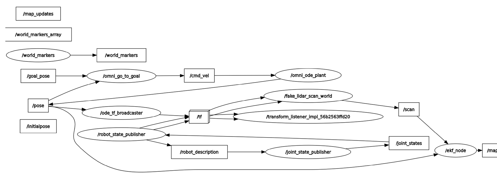

## Overview

**Simultaneous localization and mapping (SLAM)** is the problem of a robot building a map of an unknown space while working out where it is in that map, using only its own sensors. For my Autonomy II final project, I built an **EKF SLAM** package in **ROS2** for a simulated three-wheeled omnidirectional robot: an **extended Kalman filter** tracks the robot's pose, **ICP scan matching** against the map corrects odometry drift, and a **log-odds occupancy grid** builds the map from lidar scans, all visualized live in **RViz2**. I then explored **ORB-SLAM3**, a state-of-the-art visual SLAM system, on real hallway footage to see how a modern method behaves outside a clean simulation.

## The Challenge

Localization and mapping depend on each other: an accurate map needs an accurate pose, and an accurate pose needs a map to check against. Wheel odometry alone drifts without bound, and every bit of pose error gets baked into the map. A working SLAM system has to fuse noisy odometry with noisy sensor data, decide which measurements to trust, and keep running in real time inside a ROS2 system of separate nodes that all have to agree on coordinate frames and timing.

## My Role & Scope of Work

This was an individual project. The robot simulation framework (the omnidirectional plant, TF broadcaster, simulated lidar, and world markers) came from the instructor or from earlier course assignments. I built the SLAM system and the package around it:

- **EKF SLAM node (written from scratch):** the core node, `ekf_node`, which runs the EKF prediction and correction steps, ICP scan matching, and occupancy-grid mapping, and publishes the live map.
- **SLAM library (adapted):** converted the instructor's standalone Pygame EKF/ICP/occupancy-grid simulation into a reusable function library for the ROS2 package.
- **Filter design:** derived and tuned the process model, its Jacobian, and the process and measurement noise covariances.
- **ROS2 integration:** built the package (nodes, launch file, URDF, RViz2 configuration) and wired the topics into three pipelines: simulation, sensing, and control.
- **ORB-SLAM3 exploration:** built and ran ORB-SLAM3 on recorded video and analyzed where and why its tracking failed.

## System Design

### ROS2 Architecture

The package runs as a set of ROS2 nodes split into three pipelines:

- **Simulation:** the omnidirectional robot plant integrates velocity commands into a ground-truth pose, which is broadcast into the TF tree.
- **Sensing:** a simulated lidar ray-casts against the world geometry and publishes scans, and the EKF node turns those scans and the odometry into a pose estimate and a map.
- **Control:** clicking a goal with RViz2's 2D Goal Pose tool drives the robot there with a go-to-goal controller.

### Extended Kalman Filter

The filter estimates the robot's pose [x, y, θ].

- **Prediction:** on each odometry update, the motion since the last step is rotated from the world frame into the robot's body frame and propagated through a **nonlinear omnidirectional kinematic model**. The model's **Jacobian**, linearized about the current heading, carries the covariance forward along with the process noise.
- **Process noise (Q):** sized for ±5 cm in translation and ±2° in heading per step.
- **Correction:** ICP returns a full-pose measurement (H = I), corrected with a **Joseph-form covariance update** for numerical stability, with heading residuals wrapped to ±π.
- **Measurement noise (R):** sized for the ICP's expected accuracy of ±4.5 cm and ±1.5°. Because R is smaller than Q on every axis, the filter trusts a good scan match over dead reckoning.

### ICP Scan Matching

Once the map has enough occupied cells to match against, each new lidar scan is projected into the world using the predicted pose, then aligned to the map's occupied cells with **iterative closest point (ICP)**, solving each rigid-body step with **SVD**. A match is only accepted as a measurement if it has enough correspondences and stays within position and heading correction limits, which rejects implausible jumps before they corrupt the estimate.

### Occupancy Grid Mapping

With the pose corrected, each lidar beam updates the map with **log-odds ray tracing**: every cell between the robot and the beam's hit point is marked more likely free, and the hit cell more likely occupied. Log-odds makes each update a simple addition, and lets evidence build up over many scans instead of trusting any single one.

## ORB-SLAM3 Exploration

To compare against a modern method, I built and ran **ORB-SLAM3** in ROS2 on recorded hallway video. It tracks visual feature points between frames to estimate the camera's trajectory and build a sparse 3D point map, at a much higher computational cost than EKF SLAM. It ran noticeably better on a desktop PC than on a laptop.



Tracking worked well along straight corridors but was **frequently lost at turns and corners**. Turning against a nearby wall shrinks the field of view to a few trackable points; when the points are all far away, the estimated motion comes out too small; and fast turns combined with dropped frames break tracking entirely, sometimes resetting the camera's position in the map. The tape markers on the floor helped only along the walked path, and being flat, gave little 3D structure. Slower turns, more open spaces, and distinct 3D markers throughout the environment would all improve it.

## Results

The EKF SLAM package worked end to end: commanding the robot around with RViz2 goal poses, the occupancy map initialized and filled in as the robot explored, with walls and obstacles resolving as scans accumulated.



Some mapping error and localization drift remained, visible as slightly blurred or doubled walls. When a scan is inconsistent but not far enough off to be rejected, it nudges the estimate and blurs the map; the lidar's limited range also constrained how much the robot could see from any one spot.

## Key Methods & Tools

| Method / Tool | Used for |
| --- | --- |
| **ROS2** (Python, `rclpy`) | Package, nodes, topics, launch, and TF |
| **RViz2** and **RQT** | Live visualization of the robot, scans, and map; system graph |
| **Extended Kalman filter** | Pose estimation from odometry and scan matches |
| **ICP with SVD** | Scan-to-map alignment for pose corrections |
| **Log-odds occupancy grid** | Probabilistic mapping from lidar beams |
| **URDF** | Robot model for visualization and TF |
| **ORB-SLAM3** | Visual SLAM comparison on real video |

## Challenges & Lessons Learned

- **Gating measurements matters as much as the filter.** ICP will always return some answer, so the acceptance checks (minimum correspondences, maximum position and heading jumps) are what keep a bad match from corrupting both the pose and the map. The drift that remained came from matches that were wrong but plausible enough to pass.
- **Sensor limits cap what an estimator can do.** Limited lidar range meant less data per position and more pose uncertainty. A longer range, higher scan rate, and finer grid would help, at the cost of computation, which is always a constraint on a real robot.
- **Modern methods are powerful but fragile.** ORB-SLAM3's failures at corners came from the environment and the motion (few features, distant points, fast turns), not bugs, a reminder that sensing conditions and motion planning are part of SLAM design.
- **ROS2 rewards strict structure.** Most of the friction came from ROS2's package conventions, like an ORB-SLAM3 build that failed until an expected (empty) `config` folder existed. Clearing stale builds and caches resolved the rest.
