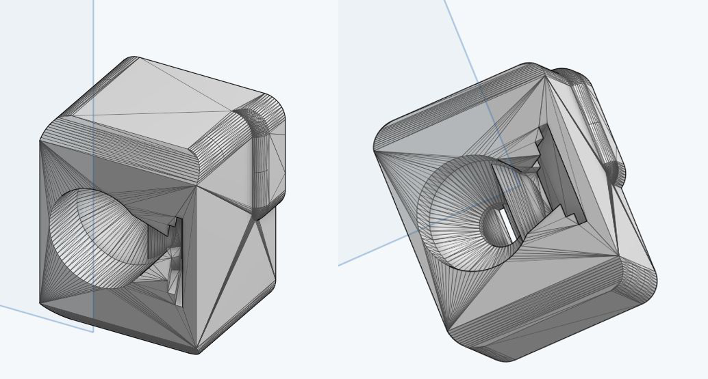
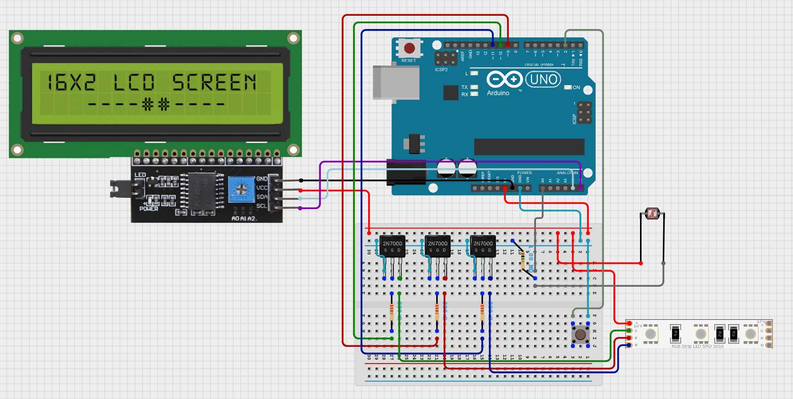
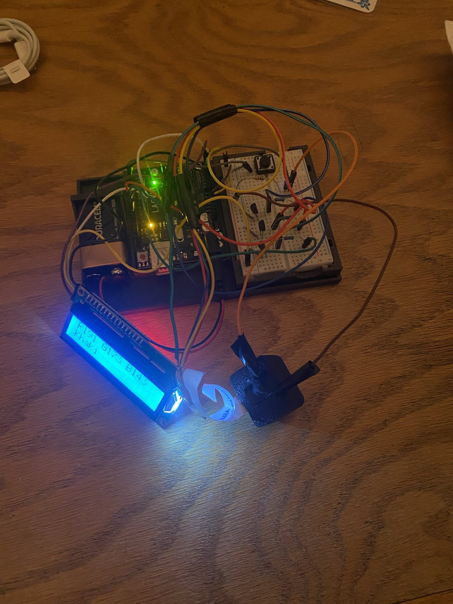

## Overview

A compact color detector built on an **Arduino UNO**. Press the button and it flashes red, green, and blue light onto a surface, measures how much of each is reflected with a single **light-dependent resistor (LDR)**, converts those readings to RGB values, and finds the closest match in a library of **672 named colors**, showing the RGB values and color name on a 16×2 LCD. I built it for a UVM Optoelectronics course, starting from HackMakeMod's [LDR Color Checker](https://hackmakemod.com/blogs/projects/ldr-color-checker) design and updating and expanding it. I designed the circuit, wrote the firmware in **C++ (Arduino)** and a **Python** tool to build the color library, and assembled the device myself.

## The Challenge

An LDR can't see color: its resistance only drops as total light intensity rises, so on its own it measures brightness and nothing else. The trick is to control the light instead of the sensor. Any color can be described by how much red, green, and blue it reflects, so by lighting a surface with **one color at a time** and measuring the reflection after each flash, a single brightness sensor can build up a full RGB reading.

That raises the real engineering problems: making raw sensor readings comparable across surfaces and lighting conditions, rejecting noise, and turning an RGB measurement into a meaningful color name, all on a microcontroller with only 2 KB of RAM.

## My Role & Scope of Work

This was an individual project; I handled everything from the circuit to the code:

- **Circuit design:** RGB LED drive through MOSFETs, the LDR voltage-divider input, and the button and I²C LCD interfaces.
- **Hardware assembly:** soldered the LED segment and built the circuit with a 3D-printed light shroud.
- **Firmware (C++/Arduino):** sampling, noise filtering, calibration, button handling, color matching, and the LCD interface.
- **Color library tooling (Python):** a parser that turns a 672-entry named-color list into a header file stored in flash memory.

### What I Changed from the Original Design

HackMakeMod's LDR Color Checker was the starting point. I expanded it in four main ways:

- **Color library: 15 → 672 colors.** The original recognized 15 colors. I built a 672-color named library, generated by a Python script and stored in flash memory.
- **Calibration instead of fixed thresholds.** The original used hardcoded thresholds. I added white and black calibration routines, so readings are scaled to the actual LED, sensor, and lighting.
- **Filtering and a progressive search.** With a library 45 times larger, I added median-of-3 filtering to stabilize readings and a progressive nearest-match search to keep matching fast.
- **Different hardware.** I used a different display, LDR, and RGB LEDs, and a modified version of the shroud.

## System Design

### Hardware

The LED is a single segment cut from a 5 V **5050 RGB LED strip**, with separate red, green, and blue channels. The strip draws more current than an Arduino pin can supply, so each channel is switched through a **2N7000 MOSFET** with a 220 Ω gate resistor, and the Arduino drives the three channels from pins D9–D11.

The **10k LDR** sits in a **voltage divider** with a 1 MΩ resistor, feeding the Arduino's analog input A0, so more reflected light means a higher voltage reading. A push button on D2 (using the internal pull-up) starts scans and calibration, and a **16×2 LCD with an I²C backpack** displays results. A **3D-printed shroud**, modified from HackMakeMod's design, holds the LED and LDR side by side, aligned for reflection, and blocks as much ambient light as possible.

### Firmware

The firmware is written in **C++ for the Arduino** and is built around a few small, focused routines:

- **Sampling.** To read one channel, the firmware turns on that LED color, waits 30 ms for the light and LDR to settle, takes an analog reading, and turns the LED off. Each channel is read **three times and the median is kept**, which filters out noise spikes.
- **Two-point calibration.** On startup (and on a double-press of the button), the device walks the user through scanning a **white** surface and then a **black** surface. White sets the maximum reading for each channel and black sets the minimum. Every later reading is scaled linearly between those bounds to a 0–255 RGB value, so the output adapts to the specific LED, sensor, and lighting. A guard catches a reversed calibration so a mistake can't crash the math.
- **Button handling.** A single press runs a scan; two presses within 300 ms re-enter calibration, with software debouncing on each press.

### Color Matching

There isn't a named color for every possible RGB value, so the device has to find the **closest** match. I collected **672 named colors** with their RGB values from 99Colors and wrote a **Python parser** that converts the list into a C header. The table is stored in **PROGMEM** (flash) rather than RAM, which is what lets all 672 names and values fit on an Arduino UNO without running out of memory.

To find a match, the firmware runs a **progressive search**: it first looks only at colors within ±5 of the measured value on every channel and picks the one with the smallest **Manhattan distance** (the sum of the red, green, and blue differences). If nothing falls inside that window, it widens the tolerance in steps of 5 (up to ±50) and searches again. Starting narrow keeps each pass cheap, and the scan finishes with no noticeable delay.

## Key Hardware

| Hardware | Role in the device |
| --- | --- |
| **Arduino UNO** | Microcontroller running the firmware |
| **10k LDR** (photocell) | Measures reflected light intensity |
| **5050 RGB LED** | Lights the surface with red, green, and blue in turn |
| **2N7000 MOSFETs** | Switch the LED channels at currents the Arduino can't supply directly |
| **16×2 LCD with I²C backpack** | Displays the RGB values and color name |
| **3D-printed shroud** | Aligns the LED and LDR and blocks ambient light |

## Results

The detector **worked well, accurately identifying the colors of most solid surfaces** both in testing and in a live demo. All 672 colors live locally on the Arduino UNO with no memory issues, and matching is fast enough that there's no noticeable wait between the end of a scan and the result appearing on the screen.

In the photo at the top of this page, for example, it reads a surface as **R191 G173 B143** and names it **"Khaki"**.

It struggled most **near the extremes, close to white and black**. There, all three RGB values are low (or all are high), so the differences between them are small, and small measurement errors turn into large errors in the output. A very dark red, for example, can easily be mistaken for a very dark blue.

## Challenges & Lessons Learned

- **Calibration makes a cheap sensor useful.** Raw LDR readings depend on the specific LED, sensor, and ambient light, so they mean little on their own. Two quick reference scans (white and black) turned them into consistent RGB values, a pattern that applies to almost any analog sensor.
- **Designing for a tiny memory budget.** An Arduino UNO has only 2 KB of RAM, nowhere near enough for 672 color names. Generating the table with a script and storing it in flash memory made the full library fit, and keeping the data in a script-generated file means the color list can be changed without touching the firmware.
- **Know where the measurement breaks down.** The errors near white and black come from the measurement itself, not the code: when all three channels read nearly the same, noise swamps the small differences that tell colors apart. Improving accuracy there means better measurement, not just better matching. Next steps also include more reliable button input and replacing the jumper wires and tape with a soldered build.
