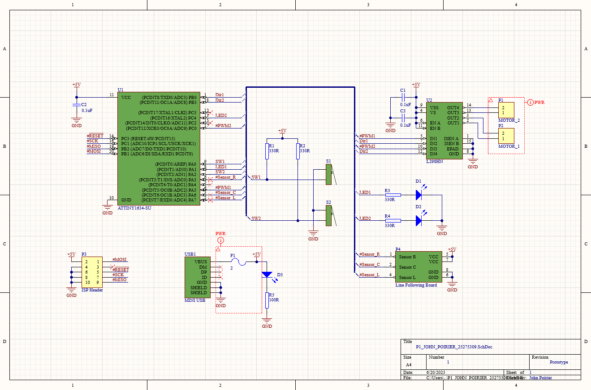
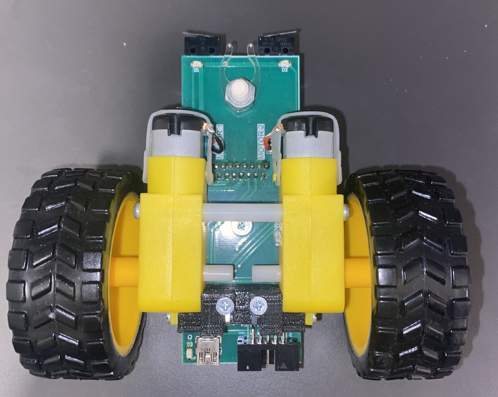
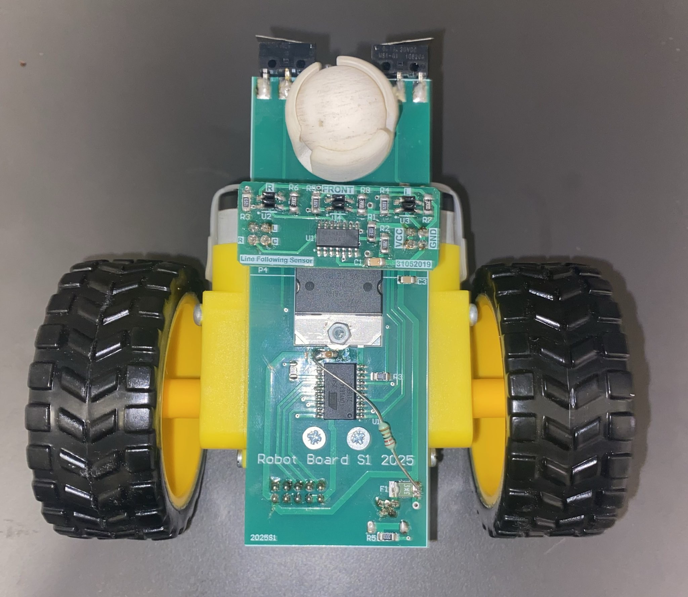
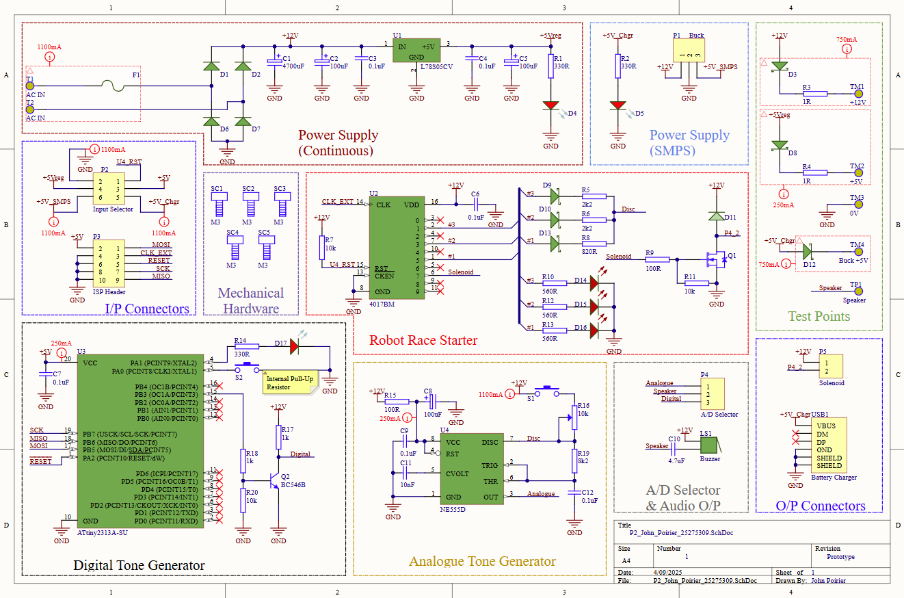
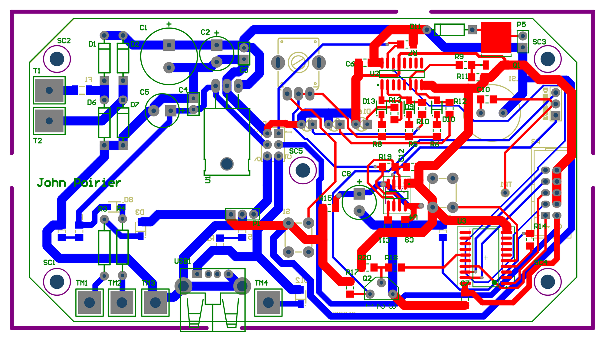

## Overview

Two connected builds from my semester abroad at the **Auckland University of Technology**, for the ENEL602 course: an **autonomous line-following robot** and the **Starger**, the class's robot race-starter and power-supply board.

The robot follows a black line using three IR sensors, correcting its steering as it drifts and backing away when it bumps into something. I designed its **PCB in Altium Designer**, assembled the board, and wrote the firmware in **bare-metal C** on an **ATtiny1634**, programming the timers and I/O registers directly. After several iterations of its state-based controller, my robot **placed 3rd overall out of 25+ students** in the class race and set the **fastest single track time: 44 seconds**.

The **Starger** (short for robot STARter and battery charGER) combines a rectified power supply, a tone generator with both analogue (555 timer) and digital (microcontroller) clock sources, and a race-starter circuit on a PCB I designed, which I then characterized on the bench and in simulation.

## The Challenge

Line following is one of the simplest forms of autonomy: sense where the line is, steer to stay on it. Doing it on custom hardware means getting every layer right: a PCB that meets fixed layout constraints, motors driven through an H-bridge with PWM, raw sensor inputs, and control logic that reacts fast enough to hold the line through curves at speed, all on a tiny 8-bit microcontroller. And in a race, it isn't enough to stay on the line; the robot has to be quick and consistent too.

## My Role & Scope of Work

Both builds were individual work:

- **PCB design (Altium Designer):** laid out both the robot board and the Starger board. For the robot, we were given the component list, the board dimensions, a two-layer limit, and a goal of fewer than 11 vias; the layout itself was mine.
- **Assembly:** populated surface-mount parts with a pick-and-place machine, hand-soldered the rest, and built both boards into their enclosure or chassis.
- **Firmware (C, AVR):** register-level code for the robot (PWM motor control, IR line sensing, bumpers, and the line-following controller) and for the Starger's digital tone generator.
- **Controller development:** iterated through several versions of the robot's state-based controller to improve speed and reliability on the race track.
- **Testing & fault-finding:** bench-tested the Starger's power supply and tone generator against Altium simulations, and diagnosed and fixed two power problems on the robot.
- **Research:** a structured literature review (using Scopus) comparing line following with the sensing used in real autonomous vehicles, which pointed to multi-sensor fusion.

## The Line-Following Robot

### Electronics & PCB

The robot is built around an **ATtiny1634** microcontroller and an **L298HN dual H-bridge** that drives the two gear motors, with the microcontroller sending each motor a **PWM speed signal and a direction signal**. A separate sensor board with three **IR reflective sensors** (left, center, right) plugs into the main board, and two **bumper switches** at the front detect collisions, each with an indicator LED. Power comes in through a fused **mini-USB connector**, and a 10-pin **ISP header** is used to program the microcontroller.

For the PCB, we were given the components, the board dimensions, a **two-layer** limit, and a target of **fewer than 11 vias**. I designed the layout, placing and routing everything to meet those constraints.

.")

### Assembly

Most of the surface-mount components were placed and soldered with a **pick-and-place machine**, and the rest were hand-soldered. With the main board and sensor board assembled, I connected the motors, then mounted the 3D-printed body and spacer, the 3D-printed front wheel, the drive wheels, and a battery pack holder.

### Firmware & Control Logic

The firmware is written in **C** for the AVR, configuring the hardware directly through its registers. **Timer0 runs in fast PWM mode**, with its two compare channels setting the left and right motor speeds; reversing a motor flips its direction pin and the PWM output polarity. The code was developed in **Microchip Studio** and flashed through the ISP header with an **AVR Dragon** programmer.

I brought the robot up in stages: first the motors (tuning them by trial and error until it drove straight, which ended up being 95% power on the right motor against 100% on the left), then the sensors and bumpers, and finally the behavior. The controller is **state-based**: each loop, it checks the bumpers first, then reads the three line sensors and chooses an action from the pattern. The final version, refined over several iterations, works like this:

| What the robot senses | What it does |
| --- | --- |
| Line under the center (or all three sensors) | Drive straight |
| Line under the center and right sensors | Gentle right correction (slow the right motor to 75%) |
| Line under the right sensor only | Pivot right (stop the right motor) |
| Line under the center and left sensors | Gentle left correction (slow the left motor to 75%) |
| Line under the left sensor only | Pivot left (stop the left motor) |
| No line under any sensor | Back up slowly to find the line again |
| Left or right bumper pressed | Reverse away from the obstacle for 0.75 s |

Graded responses (a gentle correction when the line is slightly off-center, a full pivot when it's at the edge) let the robot take curves smoothly instead of zig-zagging, which is what made it fast.

## The Starger: Race Starter & Power Supply

The Starger was the first build of the course: a PCB in a drilled plastic enclosure that powers and starts the robot races. I designed its PCB in Altium Designer, assembled it, and then characterized its power supply and tone generator on the bench.

### Design

- **Power supply:** a **full-wave rectifier** with a smoothing capacitor provides an unregulated **±12 V** supply, and an **L78S05CV linear regulator** provides a regulated **5 V** rail. A fuse, sacrificial resistors, and diodes protect the circuit from overcurrent and reverse current.
- **Analogue tone generator:** an **NE555 timer** in astable mode drives a piezo buzzer, with a potentiometer setting the frequency.
- **Digital tone generator:** an **ATtiny2313A** generates tones in hardware. I configured **Timer1 in CTC mode** to toggle its output pin on each compare match, producing a 50% duty-cycle square wave, with the firmware choosing the prescaler and compare value for each target frequency.
- **Race starter:** a **4017 counter** sequences the start, and can trigger the analogue tone generator.

### Testing & Simulation

**Power supply load testing.** Using an oscilloscope, a multimeter, and a variable electronic load, I stepped each output from no load up to 200 mA and recorded the output voltage and ripple:

| Output | Voltage, no load → 200 mA | Ripple (peak-to-peak), no load → 200 mA |
| --- | --- | --- |
| 12 V unregulated | 12.5 V → 11.2 V | 240 mV → 600 mV |
| 5 V regulated | 4.86 V → 4.49 V | 90 mV → 134 mV |

Both outputs sag as load increases, as expected for a capacitor-smoothed rectifier, but the regulated 5 V rail holds its ripple far lower. An **Altium simulation** of the rectifier showed the same trend: high ripple at heavy load, much less at light load.

 and the regulated 5 V supply (right, 134 mV ripple).")

**Tone generator testing.** I wrote firmware to step the digital tone generator through a full octave, from C5 to C6, and measured each tone on the oscilloscope. Every note landed **within about 1%** of its target:

| Target (Hz) | 523 | 587 | 659 | 698 | 784 | 880 | 988 | 1047 |
| --- | --- | --- | --- | --- | --- | --- | --- | --- |
| **Measured (Hz)** | 517.7 | 585.1 | 654.4 | 696.1 | 776.4 | 877.2 | 984.3 | 1043 |

For the analogue tone generator, increasing the potentiometer resistance lowered the frequency (4 kΩ → 556 Hz, 8 kΩ → 397 Hz, 11 kΩ → 181 Hz), matching the 555 timer simulation in Altium. Both showed that below about 4 kΩ the circuit can no longer produce a clean square wave.

, and the 555 timer's analogue output at 556 Hz (right).")

**Functional testing.** The assembled Starger passed all of its functional tests: a very high resistance between power and ground (in the expected 12–14 MΩ range, ruling out shorts), the indicator LED lighting on power-up, and a stable DC output of about 5 V.

## Key Hardware

| Hardware | Role |
| --- | --- |
| **ATtiny1634** microcontroller | Robot: runs the line-following firmware |
| **L298HN** dual H-bridge | Robot: drives the two gear motors |
| **IR reflective line sensors** | Robot: detect the black line (left, center, right) |
| **Bumper switches** | Robot: detect collisions at the front |
| **AVR Dragon** programmer | In-system programming over the ISP header |
| **ATtiny2313A** microcontroller | Starger: digital tone generation with Timer1 in CTC mode |
| **NE555** timer | Starger: analogue tone generation |
| **L78S05CV** linear regulator | Starger: regulated 5 V supply |
| **Custom PCBs** | Robot and Starger boards, both designed in Altium Designer |

## Results

The final robot, after several iterations of its state-based controller, **placed 3rd overall out of 25+ students** in the class race and recorded the **fastest single track completion time, 44 seconds**.



The Starger **passed all of its functional tests**, and bench characterization confirmed the design: both power rails behaved as expected under load, with the regulated rail holding ripple to about a fifth of the unregulated one, and the digital tone generator hit every note of its octave within about 1%.

## Challenges & Lessons Learned

- **The programmer kept browning out the robot.** Once assembled, the robot would lose power whenever the AVR Dragon was connected, and Microchip Studio couldn't detect it. The cause turned out to be the battery pack, which couldn't supply stable enough power with the programmer attached. Swapping the battery pack fixed it, a reminder to check the power supply first when a device misbehaves.
- **An undersized filter capacitor froze the robot.** The capacitor filtering the ATtiny1634's power input was too small, so the robot would intermittently freeze and stop reading its sensors. I replaced it with a larger capacitor and hand-soldered a current-limiting resistor between the fuse and the capacitor (visible in the underside photo), which made the robot stable.
- **Fast is a tuning problem, not just a logic problem.** Identical commands to both motors didn't produce a straight line, so the outputs had to be tuned empirically (95% vs. 100%), and the controller went through several versions before it was both quick and reliable enough to win heats. The race result came from that iteration, not the first working version.
- **Small assembly mistakes are cheapest to catch early.** On my first pass with the pick-and-place machine, I applied too much solder paste, and it bridged between pads once the components were placed. I caught it before reflow, cleaned the board, and redid it. Misaligned enclosure holes were similarly fixed by filing and deburring rather than starting over.
