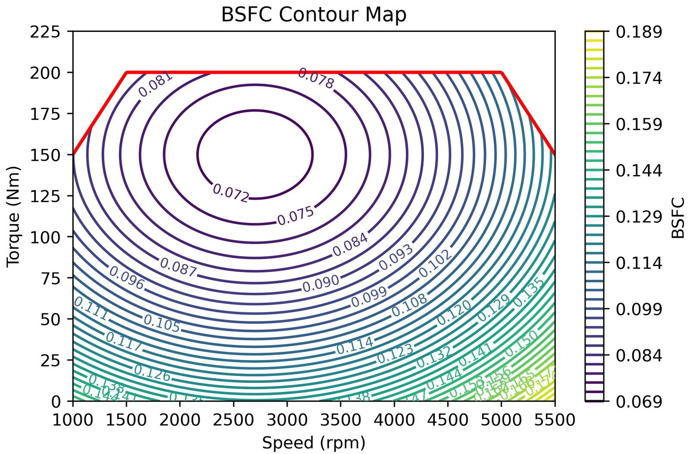
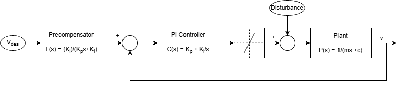
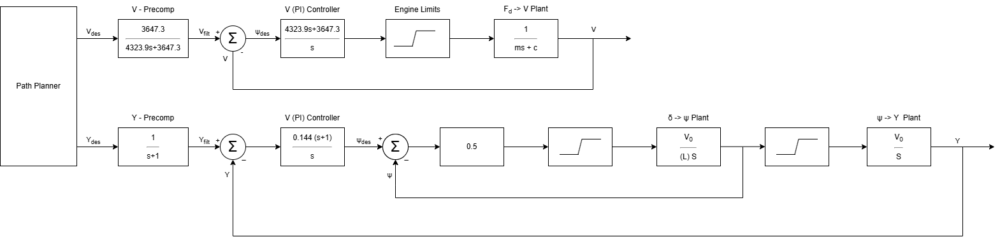
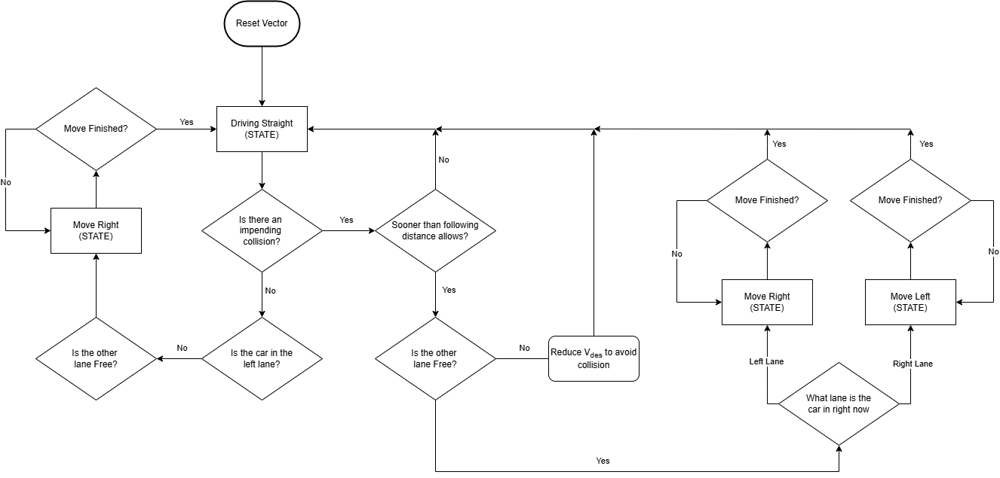
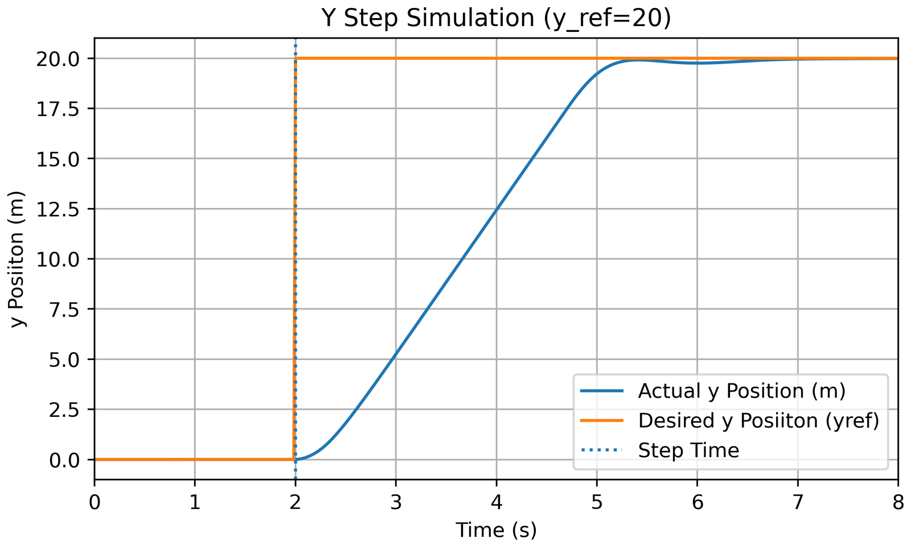

## Overview

A simulated autonomous car that holds its speed, steers between lanes, overtakes slower traffic, and minimizes its own fuel consumption. Working from a physics model of the vehicle, we derived and **linearized** its dynamics, designed a **PI cruise controller** and a **cascaded steering controller** from first principles, then added a **model predictive controller (MPC)** that adjusts speed to save fuel and a **finite-state machine** that plans lane changes. Everything was implemented and simulated in **Python** and validated in **MATLAB**. With the MPC active, the car used **18% less fuel** over the same drive (146 g vs. 179 g) while never violating its safe following distance.

## The Challenge

Each piece of a self-driving car's control stack is a classic controls problem on its own, but they all interact. The vehicle's dynamics are **nonlinear**: air drag grows with the square of speed, hills add gravity forces, and steering is limited to a small angle. The controllers had to meet strict specifications (no overshoot, fast rise and settling times, and zero steady-state error despite disturbances) on a model they were designed from a linear approximation of. On top of that, the planner had to save fuel without compromising safety, and run fast enough to keep the simulation at **60 frames per second or more**.

## My Role & Scope of Work

This was a two-person project. I contributed to every part of the system, and led three areas in particular:

- **Cruise control (lead):** linearized the longitudinal dynamics, designed the critically damped PI controller and precompensator, and implemented and validated it, including the anti-windup fix.
- **MPC fuel optimization (lead):** designed and built the model predictive controller that picks the fuel-optimal safe speed over a 10-second horizon while keeping the simulation at 60+ FPS.
- **Analysis (lead):** controller validation and performance analysis: step responses, rise and settling times, gain and phase margins, linear-vs-nonlinear comparisons, and the fuel-consumption studies.
- **Supporting work:** helped with the vehicle model, the lateral controller, and the lane-change state machine.

## System Design

### Vehicle Model

The simulation starts from a physics model of a 1,300 kg car. The engine's driving force is balanced against **quadratic air drag**, **rolling resistance**, and **gravity on hills**, on a road profile with grades of up to 5%. Fuel use comes from a **brake-specific fuel consumption (BSFC)** map, which captures how efficiently the engine burns fuel at each combination of engine speed and torque.

Simulating constant engine force on a hilly road showed a counter-intuitive result: fuel economy still oscillated. Fuel use depends on **power**, not force, so as speed and road grade change, the engine's operating point moves around the BSFC map, and efficiency moves with it.

### Cruise Control

To design the speed controller, we **linearized** the longitudinal dynamics around 100 km/h with a first-order Taylor expansion of the drag term, which gives a first-order plant. We checked the linear model against the nonlinear dynamics with step inputs, and it matched closely near the operating point while drifting at a different operating point, as linearization predicts.

The controller is a **PI controller with a precompensator** that cancels the closed-loop zero. To meet the no-overshoot requirement while staying fast, the closed loop was designed to be **critically damped**, with the natural frequency chosen for a 2-second rise time.

On small speed changes the controller met every spec, but a large 50 km/h step exposed **integrator windup**: with the throttle saturated, the integrator kept accumulating error, and the car overshot by more than 25 km/h. Adding **anti-windup** brought the response back within spec.

; with anti-windup it tracks cleanly (right).")

### Lateral (Steering) Control

For lane keeping and lane changes, the heading and lateral-position dynamics were linearized with the **small-angle approximation**, giving two integrators in series: steering angle drives heading, and heading drives lateral position. The controller is **cascaded**: a proportional **inner loop** on heading, and a **PI outer loop** on lateral position that guarantees zero steady-state error despite disturbances, with a precompensator to prevent overshoot.

The first version oscillated in simulation. We traced it to the steering limit (±0.05 rad): the inner loop was saturating constantly. **Halving the inner-loop gain** kept the steering commands in range and removed the oscillation.

### Fuel-Optimizing Model Predictive Control

Instead of tracking the driver's set speed exactly, an **MPC** treats speed as slack: it may choose any speed within ±3 m/s of the driver's set speed (within the road's limits) that minimizes fuel over a **10-second prediction horizon**. Each cycle, it:

- Predicts the car's own motion with a fast **first-order model** of the closed-loop speed response, and predicts the other vehicles' positions from their relative position and speed.
- Evaluates the **fuel cost** of each candidate speed (searched in 0.1 m/s steps) using the drag model and the BSFC map.
- **Rejects any candidate** that would bring the car within **10 m** of the vehicle ahead (the requirement was 7 m, so this adds margin, including for lane changes), and picks the lowest-cost safe speed.

A coarse 1-second time step and the linearized models kept the MPC light enough to hold the simulation at 60+ FPS, and the 10-second horizon naturally discouraged abrupt accelerations.

### Lane-Change Planner

Lane changes are handled by a **finite-state machine** with three states (Drive Straight, Move Left, Move Right) following the same rules a human driver would:

1. Leave the passing (left) lane when possible.
2. If the path is blocked and the other lane is clear, change lanes.
3. If the path is blocked and the other lane isn't clear, slow down to keep a safe distance.

The planner passes the MPC's fuel-optimal speed straight through unless it needs to slow down to avoid a collision.

## Key Methods & Tools

| Method / Tool | Used for |
| --- | --- |
| **Python** (NumPy) | Vehicle simulation, controllers, and MPC |
| **MATLAB** | Linear controller validation: step responses, gain and phase margins |
| **Linearization** (Taylor series, small-angle) | Turning the nonlinear vehicle dynamics into designable plants |
| **PI control + precompensation** | Cruise control and lateral position control |
| **Anti-windup** | Preventing integrator windup under actuator saturation |
| **Model predictive control** | Fuel-optimal speed selection with safety constraints |
| **Finite-state machine** | Lane-change decision-making |

## Results



| Controller | Result |
| --- | --- |
| Cruise control | No overshoot, 2.0 s rise time, 3.5 s settling time, zero tracking error; stays in spec on large steps with anti-windup |
| Lateral control | No overshoot, 2.4 s rise time, 3.35 s settling time, infinite gain margin, 72.5° phase margin; holds up on the nonlinear model |
| MPC fuel optimization | **146 g vs. 179 g** of fuel over the same 90-second drive (**18% less**), at 60+ FPS |
| Safety | Multiple successful lane changes with no following-distance violations |

## Challenges & Lessons Learned

- **A linear design is only as good as its operating point.** Linearizing around 100 km/h gave a near-perfect model there and a poor one at 150 km/h. Designing around the speed the car actually drives at, then validating on the full nonlinear model, is what made the controllers hold up.
- **Saturation breaks controllers that look perfect on paper.** Both of the biggest problems came from actuator limits the linear design ignored: integrator windup when the throttle saturated, and oscillation when the steering hit its ±0.05 rad limit. Anti-windup and a lower inner-loop gain fixed them.
- **Performance and efficiency pull in different directions.** Halving the cruise-control gains used slightly less fuel, but broke the overshoot and settling specs. The MPC resolved that trade-off properly, by optimizing fuel explicitly within the speed and safety bounds instead of detuning the controller.
- **Real-time constraints shape the algorithm.** Keeping the MPC fast enough for 60+ FPS meant a coarse time step, simple prediction models, and a bounded search, so the design had to be good enough rather than exhaustive.
