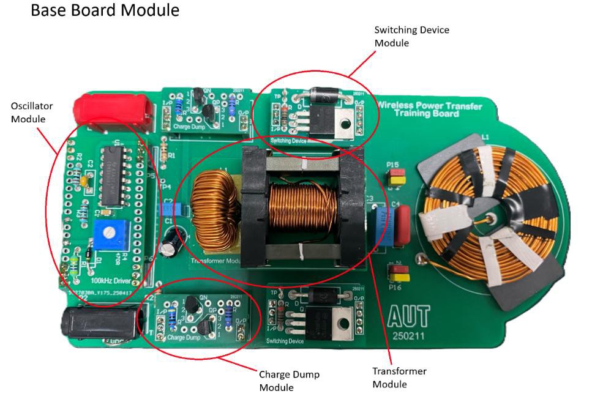
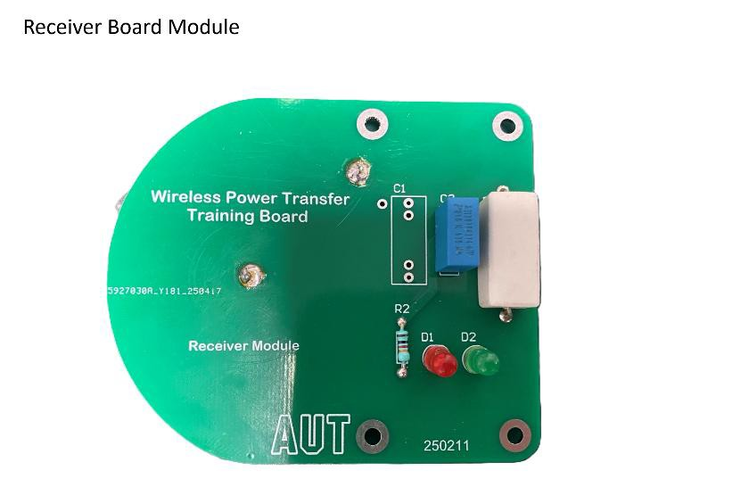
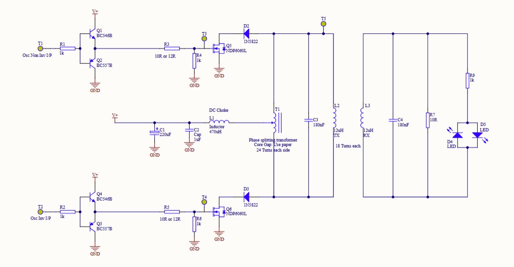

## Overview

A working **inductive wireless power transfer (WPT)** prototype: a transmitter board that drives a resonant coil, and a separate receiver board that picks up that power across an air gap with no physical connection. It's the same principle behind wireless phone chargers. I built the prototype module by module over a semester-long lab course at AUT, hand-winding its transformer and coils, tuning the transmitter and receiver to **resonance at 91 kHz**, and characterizing its MOSFET switching and its efficiency. At the best coil spacing it transferred power at **63.9% efficiency**.

## The Challenge

Inductive power transfer works by driving an alternating current through a transmitting coil; the changing magnetic field induces a voltage in a nearby receiving coil. Making that efficient takes more than two coils. The DC input has to be turned into a clean high-frequency AC drive, the switching transistors have to turn on and off fast enough to keep up, and both coils have to be tuned to resonate at the same frequency, or most of the power never makes it across the gap.

## My Role & Scope of Work

This was an individual lab project. The module board designs were provided; everything from there was mine:

- **Assembly and soldering:** built each of the six modules (oscillator, two charge-dump modules, two switching-device modules, transformer, base board, and receiver) so they could be tested individually and then together.
- **Magnetics:** hand-wound the centre-tapped phase-splitting transformer and the transmitting and receiving coils.
- **Circuit analysis:** worked out what each module does and how it contributes to the system from its schematic, since the lab didn't spell out each module's function.
- **Resonant tuning:** measured the coil inductance, chose the tuning capacitor values through analytical calculations, and tuned the oscillator to match.
- **Switching experiments:** compared two MOSFETs and three gate-drive configurations on the oscilloscope across 20–80 kHz.
- **Efficiency testing:** measured input and output power across five coil spacings.
- **Debugging:** traced a power-transfer failure and an off-spec oscillator range, and fixed both.

## System Design

The prototype is built from plug-in modules on a base board, so each stage could be tested on its own before the full circuit was assembled. The module designs were provided without an explanation of what each one does, so the descriptions below come from my own analysis of each circuit.

- **Oscillator module.** A **CD4049UBE hex inverter** turns the 5 V DC input into a square-wave AC signal. A 470 Ω trim resistor tunes its frequency.
- **Charge-dump modules.** A complementary pair of **BC546B / BC557B** transistors on each side rapidly charges and discharges the MOSFET gate capacitance, making switching faster and more reliable.
- **Switching-device modules.** **NDP6060L MOSFETs** alternately switch on during each half-cycle of the drive signal, reversing the current through the transmitter to create the alternating magnetic field.
- **Transformer module.** An inductor low-pass filters the square wave, removing its higher odd harmonics to leave a near-sinusoidal waveform at the fundamental frequency. A **centre-tapped phase-splitting transformer** then delivers each half of the waveform to the corresponding switching module. I wound it with 24 turns per side on ferrite cores, with a paper gap to control core saturation, and reached **0.988 mH** against a 1 mH design target.
- **Base board.** Connects the modules and holds EMI filtering, the **tuning capacitors**, and the **transmitting coil**, which I hand-wound with 18 turns for **14.8 µH** (designed for about 15 µH).
- **Receiver module.** A matching hand-wound coil with its own tuning capacitors, a 10 Ω load resistor that absorbs the received power, and two indicator LEDs that light when power is transferred.

To get efficient transfer, the transmitter is tuned to **parallel resonance**. I chose the tuning capacitor values analytically: starting from the oscillator's tunable frequency range and the measured 14.8 µH coil, I calculated the capacitance needed to resonate within that range. With about 206 nF, the resonant frequency is f = 1 / (2π√(LC)) ≈ **91 kHz**, and I tuned the oscillator to match.

## Experiments

### MOSFET Switching

I tested how quickly the switching stage could keep up across a 20–80 kHz drive range, comparing the **NDP6060L** against the **PSMN2R5** MOSFET, each with three gate-drive setups: no charge dump, the charge-dump modules, and dedicated FET-driver modules.

- **Without charge dumps,** both MOSFETs switched cleanly at 20 kHz but distorted badly at 80 kHz. The PSMN2R5 struggled most: its input capacitance (11,700 pF) is nearly **10 times** the NDP6060L's (1,190 pF), so its gate can't charge and discharge fast enough at high frequency.
- **With the charge-dump modules,** both produced near-square waveforms at both frequencies, and the gap between the two MOSFETs mostly disappeared, because actively dumping the gate charge cancels out most of the capacitance difference. The trade-off was a larger voltage spike on the drain at turn-on.
- **With FET drivers,** the gate and load waveforms were the smoothest of all, though drain spikes at turn-on remained.

, charge-dump modules (center), and FET-driver modules (right). Channel 1: NDP6060L; channel 2: PSMN2R5. The timebase differs between captures.")

I chose the **NDP6060L with charge-dump modules** for the final prototype: it switches faster and has smaller turn-on spikes than the PSMN2R5, and the charge dumps provide most of the waveform cleanup.

### Power Transfer Efficiency

With the circuit tuned to resonance (idle current 0.156 A), I placed spacers of different thicknesses between the transmitting and receiving coils and measured input and output power at a fixed 4.85 V input:

| Coil spacing | 2 mm | 3 mm | 4.5 mm | 6 mm | 10 mm |
| --- | --- | --- | --- | --- | --- |
| Input current (A) | 1.968 (overload) | 1.846 | 1.223 | 1.051 | 0.623 |
| Input power (W) | — | 8.95 | 5.92 | 5.09 | 3.02 |
| Output power (W) | — | 5.67 | 3.78 | 3.25 | 1.77 |
| **Efficiency** | — | 63.3% | **63.9%** | 63.9% | 58.8% |

## Results

The prototype transferred power wirelessly, lighting the receiver's indicator LEDs across every spacing tested. Efficiency peaked at **63.9% at 4.5 mm** and held steady (63.3–63.9%) from 3 mm to 6 mm, dropping to 58.8% at 10 mm as the coils' magnetic coupling weakened. Closer spacing transferred much more power (5.7 W at 3 mm), and at 2 mm the input current exceeded the supply's limit, overloading it.

## Challenges & Lessons Learned

- **Gate capacitance sets the switching speed limit.** The MOSFET experiments made a datasheet number tangible: a 10× difference in input capacitance turned into visibly distorted waveforms at 80 kHz, and active gate drive (charge dumps or FET drivers) was what made high-frequency switching clean. Choosing a switching device means weighing capacitance, speed, and turn-on transients together.
- **Resonance has to be tuned, not just calculated.** The oscillator's actual range came out at about 60–98 kHz instead of the expected 80–110 kHz. Rather than rebuilding it, I increased the tuning capacitance, which lowers the resonant frequency, until resonance fell inside the range the oscillator could reach.
- **Check the simplest connection first.** Early on, no power reached the transmitting coil. The cause was enamel insulation that hadn't been fully stripped from the hand-wound coil's leads, so they never made contact with the board's pads. Properly stripping and re-soldering them restored full power transfer.
